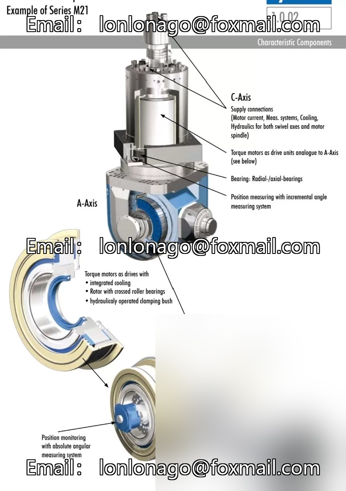
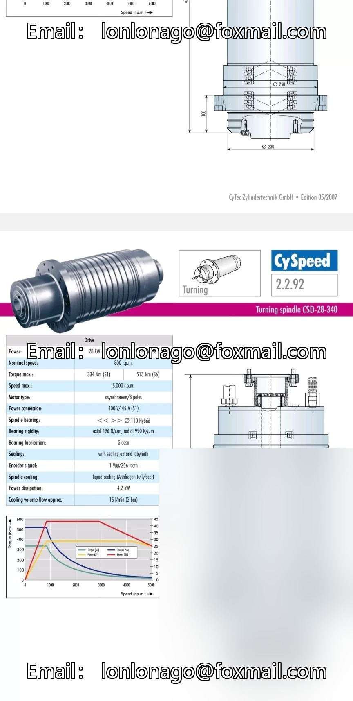
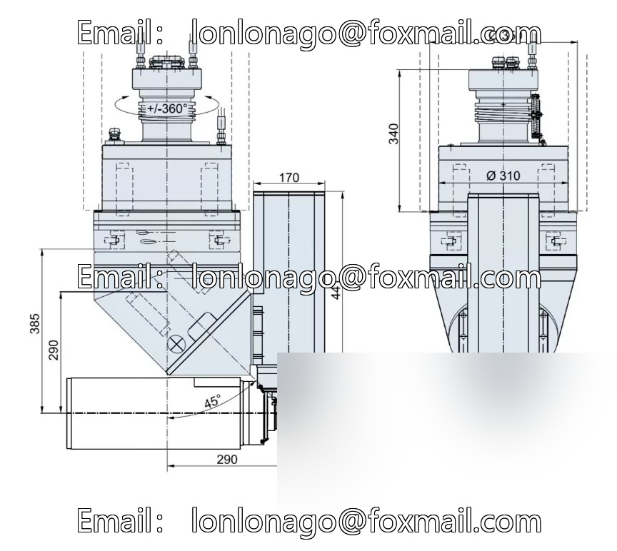
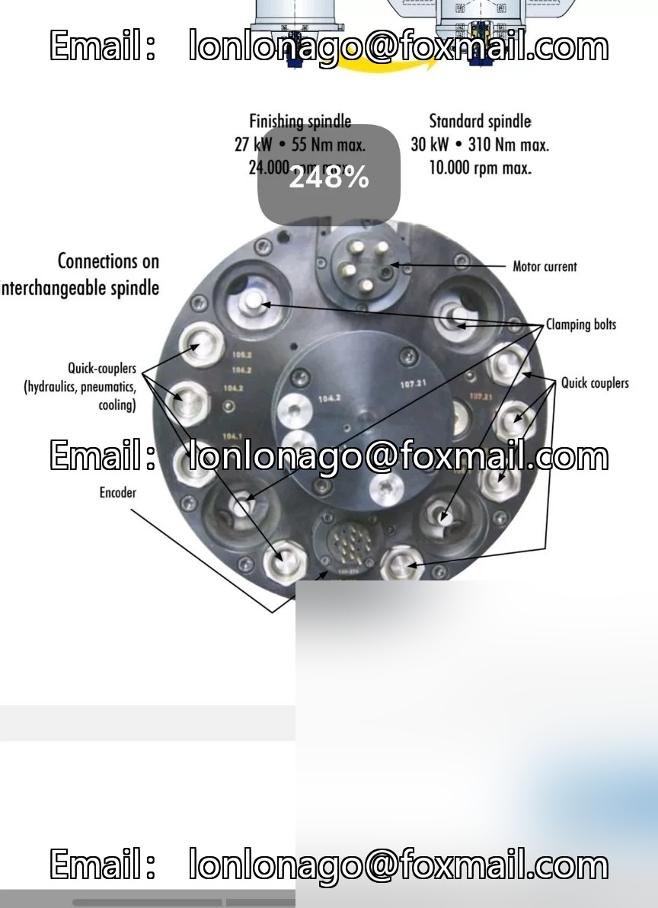
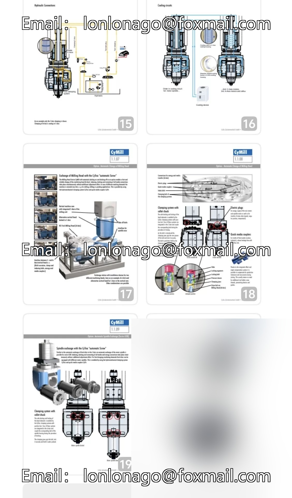
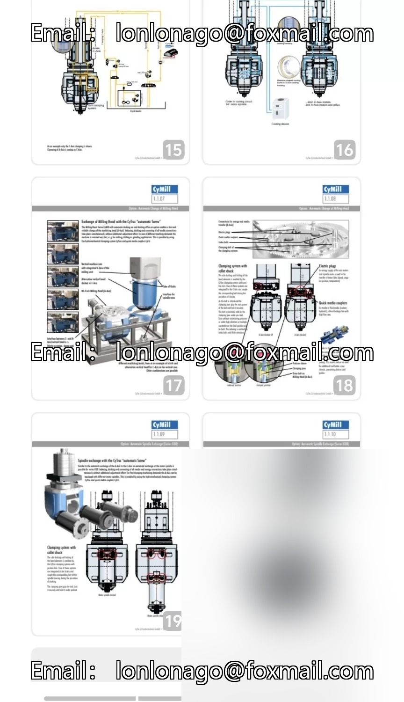

# CyMill/CySpeed series milling head product technical promotional materials

## Body

CyMill/CySpeed series milling head product technical promotional materials, PDF , 100 pages.
CyTEC SYSTEMS (CyTec Zylindertechnik GmbH)
The materials include detailed descriptions of product structure, parameters, functions, etc., suitable for industry reference.
The are non-returnable upon sale.
A direct print request is needed, and please communicate privately about any issues.
336066311

The material covers technical promotional information for the CyMill/CySpeed series milling heads, in PDF format with 100 pages, detailing product structure, parameters and functions, and includes version and edition information.

<!-- AI_ENRICHED -->

## Images

## Payment

Here is a pay link on Stripe ( https://buy.stripe.com/3cs8yP7sY87d0vu9AB ). Please contact me lonlonago@foxmail.com after funding $89, and I will send you a complete data files , thank you!

